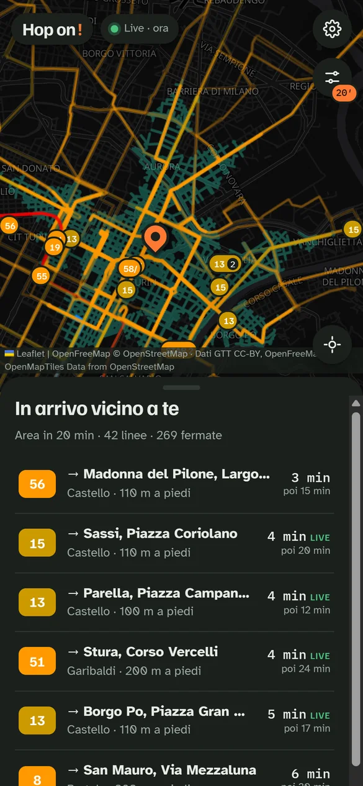
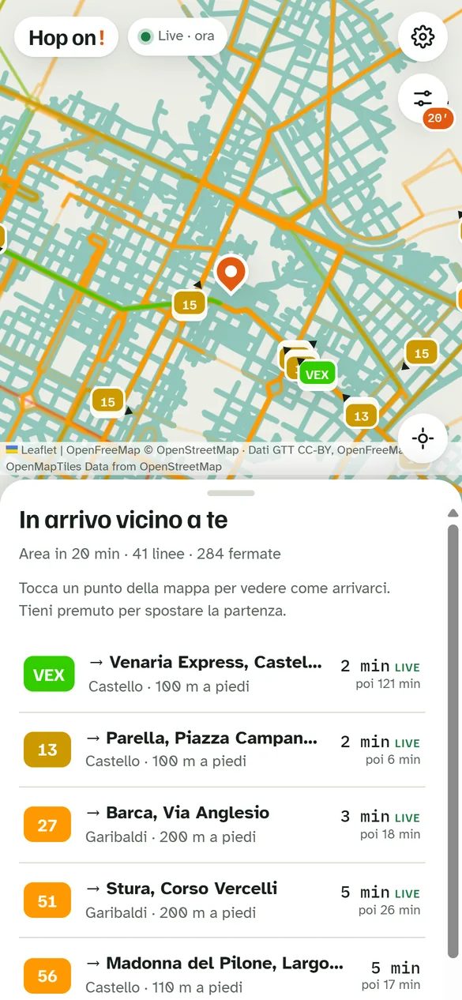
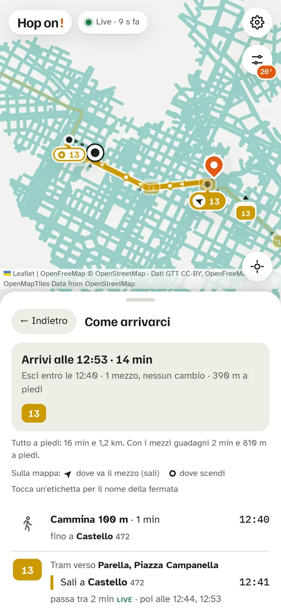
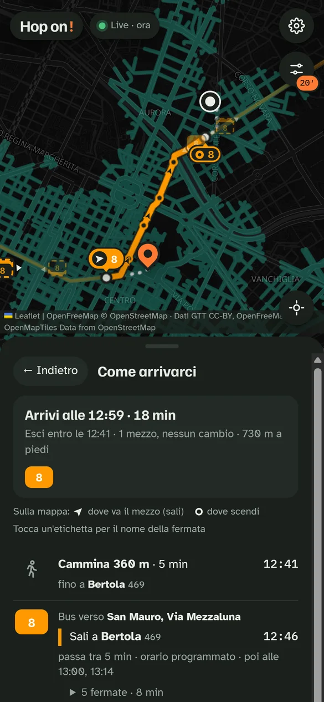
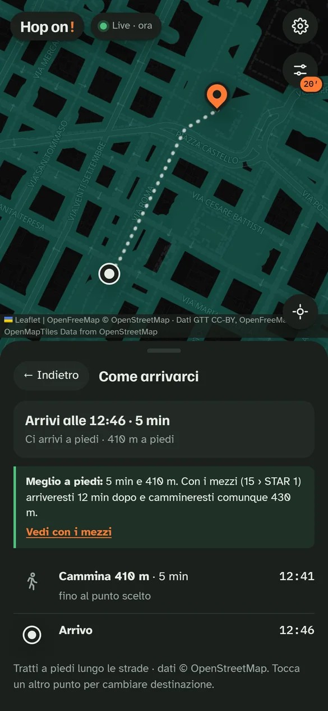
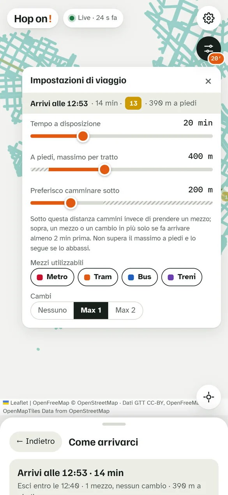

# Hop on!

**Every journey planner asks you where you want to go. Hop on! asks how much time you have.**
Standing at a stop in Turin with twenty minutes to spare, the useful question isn't "how do I get to
Via Roma" — it's "where can I actually get to from here, right now?" Hop on! answers that with a map:
pick a starting point (your GPS position or a pin), choose a time budget, and the city lights up with
everything you can reach by GTT metro, tram and bus plus walking, using the real timetables and the
live vehicle feeds. Tap any point inside the area and it tells you exactly how to get there.

<a href="https://follen99.github.io/HopOn-/" target="_blank" rel="noopener" style="display:flex;align-items:center;gap:1.1rem;margin:1.6rem 0;padding:1.1rem 1.3rem;border:1px solid rgba(42,165,148,.45);border-radius:16px;background:linear-gradient(135deg,rgba(42,165,148,.14),rgba(226,90,18,.10));text-decoration:none;color:inherit;">
  
  
    Try it live → follen99.github.io/HopOn-
    Open it on your phone in Turin. No install, no account: it runs entirely in the browser, deployed on GitHub Pages.
  
</a>

**Tech Stack:** Vanilla JS (single HTML file, no build step) | Leaflet + MapLibre (OpenFreeMap) | GTFS + GTFS-Realtime | OpenStreetMap | IndexedDB | Cloudflare Workers | GitHub Actions + Pages

## What it looks like

  
  
  

From left to right: the area reachable in 20 minutes from Piazza Castello (every teal street is
somewhere you can be in time, walking included), the "In arrivo vicino a te" list of departures you
can still catch on foot, and the itinerary that opens when you tap a point on the map.

## Use cases

### 1. "I've got 20 minutes — where can I go?"
Open the app and the reachable area is drawn immediately around your GPS position. It isn't a circle:
it's computed street by street on the real pedestrian network, so you see the shape the tram lines
give to the city. Lines you can board are drawn in full but faded, with only the stretch you can ride
within your time budget highlighted. Live vehicles appear on the map only if they are about to pass a
stop you can walk to in time — the ones you could actually catch.

### 2. "How do I get there?"
Tap any point inside the area. The bottom sheet turns into an itinerary: when to leave, which stop to
walk to, which line to board and in which direction, how many stops, and when the next ones pass —
marked **LIVE** when the time comes from GTT's real-time feed, or "orario programmato" when it's only
scheduled. On the map, an arrow marks where you board (pointing where the vehicle is heading) and a
circle where you get off.

  
  

### 3. "Is it even worth taking the bus?"
Sometimes it isn't, and a good planner should say so. Every itinerary is compared against walking the
whole way: if transit saves only a couple of minutes and barely shortens the walk, Hop on! proposes
the walk instead, with a **Meglio a piedi** box explaining why ("with tram 15 and the STAR 1 you'd arrive 12 min later and
walk 430 m anyway") and a button to see the transit option regardless. The thresholds are stricter
when the trip relies on scheduled rather than live times, because a scheduled bus is a promise, not a
fact.

### 4. "Plan it my way"

The floating trip-settings button (with the time budget in its badge) opens a panel to tune the
search: time available, maximum walk per leg, a "prefer walking under…" threshold, which modes to
use (metro, tram, bus) and how many transfers to allow. The panel stays open on top of an itinerary,
and its top row shows the updated result as you drag a slider — you can watch "arrive at 12:53, line
13, 390 m on foot" change as you allow one more transfer. A long press anywhere on the map moves the
starting point there, to plan from somewhere other than where you're standing.

## How it works

- **Isochrone engine.** A round-based **Connection Scan Algorithm** runs over ~430,000 daily
  connections (7,054 stops, 215 lines, ~15,000 trips a day) in 10–15 ms. Each round is one more
  vehicle; every arrival remembers its "parent" (trip + boarding stop, or the stop you walked from),
  so any point on the map can be turned back into a full itinerary.
- **Real walking, not crow-flies.** A Node script with a hand-written PBF decoder turns an
  OpenStreetMap extract into small gzipped tiles of the pedestrian network around GTT stops. The app
  downloads the tiles for the area it needs, stitches them into a graph, and runs a multi-source
  Dijkstra from the reached stops to colour every street by arrival time. Where the network has holes,
  walking is estimated and marked as such.
- **Live data in the browser.** GTFS-Realtime vehicle positions, trip updates and alerts are decoded
  with a protobuf decoder written from scratch (no protobuf.js). Lines with no GPS in the feed get
  positions estimated from the timetable, drawn dashed. The 16 MB GTFS zip is indexed into typed
  arrays and cached in IndexedDB.
- **Highlights that start and end at the stop.** Stops are projected onto the trip's shape with a
  dynamic-programming pass that always moves forward along it, so routes that use the same street
  twice don't snap to the wrong pass: median error dropped from 57 m to 6 m.
- **Fewer pointless transfers.** Another vehicle only counts if it gets you there at least 2 minutes
  sooner. On ~500 real itineraries this cut the average from 1.31 to 1.22 vehicles and the one-stop
  "shuttles" before another line from 43 to 28, with average arrival time unchanged (+6 s).
- **Zero-cost deployment.** GTT's servers don't send CORS headers, so a tiny Cloudflare Worker proxies
  only GTT's domains. A GitHub Actions workflow rebuilds the walking tiles from Geofabrik's North-West
  Italy extract on every push and once a month, and publishes the app to GitHub Pages.

The whole app is a single HTML file: the pure logic lives in a `<script>` block that never touches the
DOM, so it loads and runs in Node for testing against real data.

## What's next

The interface has just been slimmed down for phones; next up is smoothness on mobile (moving GTFS
indexing to a Web Worker), then a **radar mode** that follows you while you walk and warns you when a
vehicle heading your way is about to pass — the idea the whole project started from.

## Data & licences

Timetables and real-time data: GTT / Comune di Torino (aperTO), CC-BY 4.0. Streets and map:
© OpenStreetMap contributors, ODbL; base map by OpenFreeMap. GTT doesn't publish the metro in real
time, so metro times are always scheduled.
