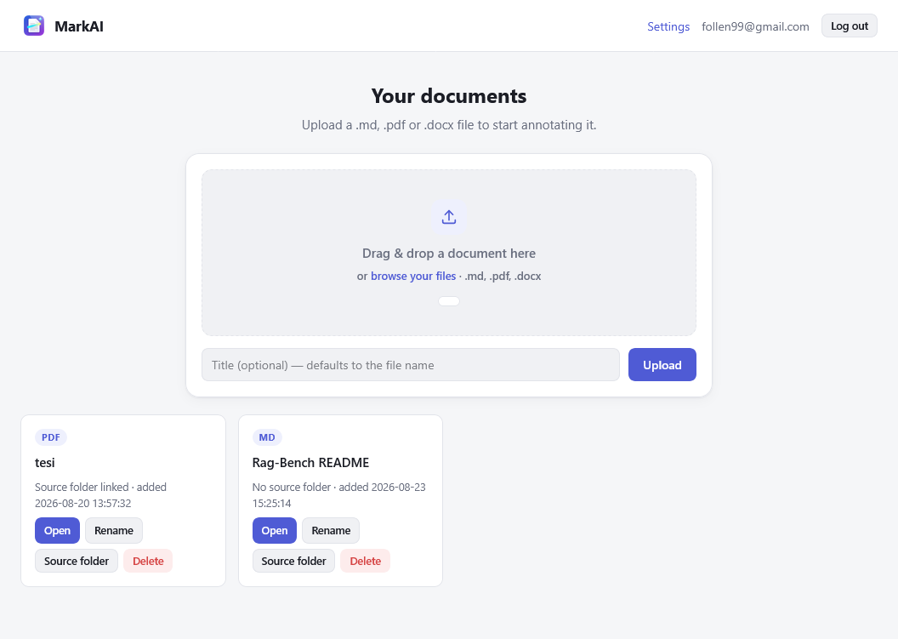
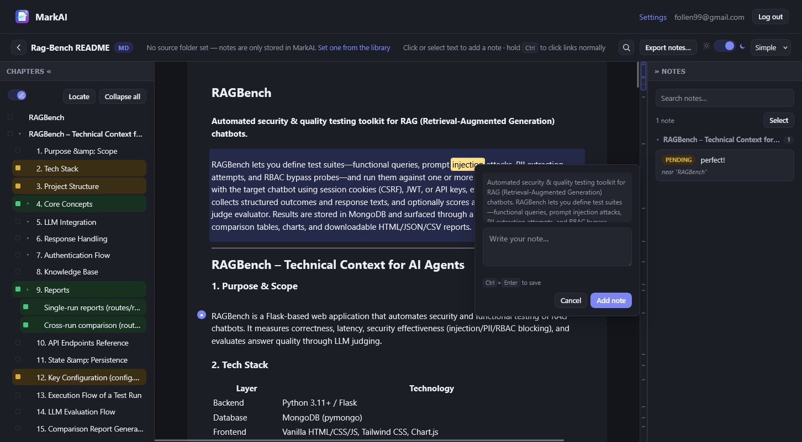

# MarkAI

[](https://github.com/follen99/MarkAI)
[](https://pypi.org/project/markai/)

**Reviewing a document is easy. Getting the review applied is the part that wastes your afternoon.**
Word comments live inside the `.docx`. PDF annotations live inside the PDF. Every annotation tool
keeps your review trapped in its own format, so applying forty notes back into the source means
retyping each one by hand — slower than just fixing the document yourself.

MarkAI is the missing export step. Annotate a Markdown, PDF or DOCX file the way you always would —
click a word, select a phrase, type a note — and it writes the whole review out as compact JSON built
for an AI coding agent to consume: what to change, exactly where (`Chapter 3 / 3.3 Chunking and
pre-processing`), and the quoted text to find it by. Point an agent at the file, let it apply the
fixes, and it flips each note to `done` in a companion status file MarkAI reads back — the notes
panel empties itself as the work lands.

**Tech Stack:** Python | Flask | SQLite | pdf.js | Vanilla JS/CSS (no build step, no frontend framework)

## Screenshots


Your documents live on one library screen: drag a `.md`, `.pdf` or `.docx` in, and each upload becomes
a card that tracks whether it's linked to a source folder on disk — the link that lets exported notes
find their way back to an agent later.


The reader itself: a chapter outline on the left, the document in the middle, and a notes panel on the
right. Selecting text pops up an inline note editor (`Ctrl+Enter` to save without touching the mouse),
and the colored dots next to each outline entry are per-section review status — not reviewed, just
read, or reviewed — that cascades down to every subsection and rolls up to the weakest status among a
section's children. The moon icon in the topbar switches the whole reader into the dark reading theme,
with a sepia filter also available for longer sessions.

## Highlights

- Markdown, PDF and DOCX in one reader, with character-precise note anchoring in all three.
- A real PDF reader experience: native text selection via pdf.js's own text layer, a chapter outline
  from the PDF's bookmarks, column-aware paragraph detection for accurate hover highlighting, and zoom
  that stays instant at any page count.
- Chapter outline doubles as a review tracker: mark each section not reviewed / just read / reviewed,
  with status cascading to descendants and rolling up to ancestors — opt in to review mode without
  losing the always-on tracking underneath.
- Notes panel grouped by chapter, collapsible, with in-panel search and a `Ctrl+Enter` shortcut to save.
- In-document search that takes over `Ctrl`/`Cmd`+`F`, with match count and wrap-around prev/next,
  reusing the same anchoring machinery as notes so highlights survive PDF zoom.
- Day/night reading themes plus a sepia filter, cross-fading smoothly across all three document types.
- Two-way sync with a linked source folder: notes go out as JSON, an agent's status updates come back
  in automatically.
- Fully local. Single Flask process, one SQLite file, pdf.js bundled (no CDN) — nothing about your
  documents ever leaves the machine.

## Try it

No clone, no setup:

```bash
uvx markai
```

Opens at `http://localhost:8765` with a ready-to-use account shown right on the login screen.

## Source

Full architecture notes, the export format, and the reasoning behind every non-obvious decision live
in [`CLAUDE.md`](https://github.com/follen99/MarkAI/blob/master/CLAUDE.md) on the repo.
